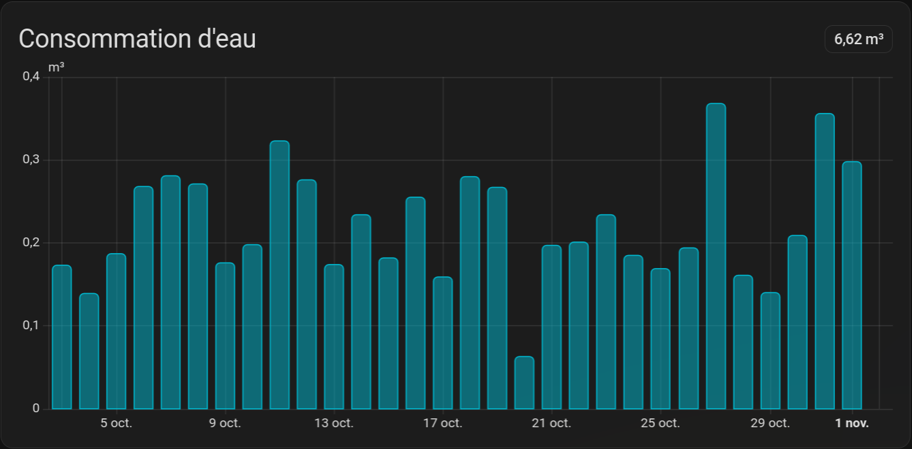

# Sogedo Water pour Home Assistant

[](https://hacs.xyz)
[](https://www.home-assistant.io)
[](https://github.com/girard-xyz/sogedo-ha/releases)
[](LICENSE)

[English](README.md) | **Français**

Intégration Home Assistant non officielle pour les compteurs d'eau [Sogedo](https://mon-compte.sogedo.fr). Elle récupère la consommation journalière et l'index du compteur, rétro-remplit tout l'historique et l'injecte dans le **tableau de bord Énergie** — eau et coût.



[](https://my.home-assistant.io/redirect/hacs_repository/?owner=girard-xyz&repository=sogedo-ha&category=integration)

## Sommaire

- [Pourquoi](#pourquoi)
- [Fonctionnalités](#fonctionnalités)
- [Prérequis](#prérequis)
- [Installation](#installation)
- [Configuration](#configuration)
- [Entités](#entités)
- [Tableau de bord Énergie](#tableau-de-bord-énergie)
- [Fonctionnement](#fonctionnement)
- [Dépannage](#dépannage)
- [Données et confidentialité](#données-et-confidentialité)
- [Contribuer](#contribuer)
- [Avertissement](#avertissement)
- [Licence](#licence)

## Pourquoi

Le portail client Sogedo n'affiche la consommation d'eau que sous forme de tableau. Le tableau de bord Énergie de Home Assistant, lui, a besoin de **statistiques à long terme**, pas d'un tableau.

Cette intégration se connecte à votre compte, transforme les données du portail en capteurs et statistiques, et les maintient à jour — pour que l'eau apparaisse à côté de l'électricité et du gaz, avec l'historique et le coût.

## Fonctionnalités

- **Consommation journalière** — eau consommée le dernier jour complet (J-1), en m³.
- **Index cumulé** — relevé actuel du compteur, `total_increasing`.
- **Historique complet** — 10 ans de consommation journalière rétro-remplis en statistiques à long terme, prêts pour le tableau de bord Énergie.
- **Historique de coût** — consommation × le prix de l'eau configuré dans le tableau de bord Énergie.
- **Connexion automatique** — l'e-mail et le mot de passe sont enregistrés une fois ; quand le jeton d'actualisation expire, l'intégration se reconnecte silencieusement.
- **Données tardives gérées** — Sogedo publie avec du retard : les 7 derniers jours sont revérifiés à chaque interrogation et les valeurs provisoires sont corrigées.
- **Bouton Actualiser l'historique** — relance le rétro-remplissage à la demande (idempotent, sans risque).
- **Interrogation toutes les 6 heures** — Sogedo ne publie que des données journalières, interroger plus souvent n'apporte rien.

## Prérequis

- Home Assistant **2024.4** ou plus récent.
- Un compte Sogedo en ligne (e-mail + mot de passe).
- [HACS](https://hacs.xyz) pour l'installation recommandée.

## Installation

### HACS (recommandé)

1. Ouvrir **HACS → Intégrations → ⋯ → Dépôts personnalisés**.
2. Ajouter `https://github.com/girard-xyz/sogedo-ha` avec la catégorie **Intégration**.
3. Installer **Sogedo Water**.
4. Redémarrer Home Assistant.

Le bouton **Add repository** ci-dessus fait la même chose.

### Manuelle

Copier `custom_components/sogedo` dans le dossier de configuration de Home Assistant :

```
config/
└── custom_components/
    └── sogedo/
```

Puis redémarrer Home Assistant.

## Configuration

1. Aller dans **Paramètres → Périphériques et services → Ajouter une intégration**.
2. Chercher **Sogedo Water**.
3. Saisir l'e-mail et le mot de passe de votre compte Sogedo.
4. Si le compte a plusieurs abonnements, choisir celui à surveiller.

Les identifiants sont enregistrés dans l'entrée de configuration de Home Assistant et servent à ouvrir une session chez Sogedo. Il faut se reconnecter uniquement en cas de changement de mot de passe Sogedo ou de modification de la page de connexion du portail.

## Entités

Les identifiants d'entité sont localisés selon la langue de Home Assistant. Voici les identifiants français.

| Entité | Description |
|---|---|
| `sensor.consommation_journaliere` | Eau consommée le dernier jour complet (J-1), m³ |
| `sensor.consommation_cumulee` | Index actuel du compteur, `total_increasing` |
| `sensor.sogedo_water_consumption` | Statistique à long terme (pas d'entité live) — **source Eau du tableau de bord Énergie** |
| `sensor.sogedo_water_cost` | Statistique à long terme (pas d'entité live) — **source Coût du tableau de bord Énergie** |
| `button.actualiser_l_historique` | Relance le rétro-remplissage de l'historique |
| `update.sogedo_water_update` | Notifications de mise à jour via HACS/Home Assistant |

> Les deux statistiques (`sensor.sogedo_water_consumption` et `sensor.sogedo_water_cost`) ont des identifiants fixes et ne changent pas avec la langue.

## Tableau de bord Énergie

1. Aller dans **Paramètres → Tableaux de bord → Énergie → Sources d'eau → Ajouter** (ou modifier la source existante).
2. **Eau du réseau** → sélectionner `sensor.sogedo_water_consumption`.
3. Renseigner le **prix** de l'eau (€/m³).

L'intégration renseigne automatiquement la statistique **Coût** (`sensor.sogedo_water_cost`) au premier rétro-remplissage. Le graphique d'historique et le détail des coûts affichent alors chaque jour, y compris les années rétro-remplies.

Après un changement de prix, appuyer sur **Actualiser l'historique** pour recalculer la série de coût.

## Fonctionnement

- **Authentification** — Sogedo utilise Azure AD B2C avec le flux mot de passe désactivé : l'intégration pilote la page de connexion du portail, récupère un code d'autorisation et l'échange contre des jetons. Le jeton d'actualisation est conservé ; lorsqu'il expire, les identifiants enregistrés servent à se reconnecter.
- **Interrogation** — toutes les 6 heures. Sogedo publie les données de la veille, parfois plus tard.
- **Statistiques** — l'intégration écrit des cumuls dans le recorder, pour que le *change* journalier du tableau de bord Énergie corresponde à la consommation (et au coût) réels.
- **Rétro-remplissage** — au premier démarrage, et à la demande via le bouton, tout l'historique (10 ans) est récupéré par tranches d'un an et écrit de façon idempotente.
- **Données tardives** — chaque interrogation revérifie les 7 derniers jours et réécrit cette fin de série, afin de corriger les jours publiés en retard au lieu de les figer à zéro.

## Dépannage

**Le tableau de bord Énergie n'affiche aucune consommation récente.**
Sogedo publie J-1 au mieux, parfois avec plusieurs jours de retard. Les capteurs conservent la dernière valeur publiée ; appuyer sur **Actualiser l'historique** pour forcer une revérification dès que le portail a la donnée.

**« Sogedo backfill failed; retrying next poll » dans les journaux.**
Généralement une erreur réseau/API passagère. L'intégration réessaie automatiquement ; le bouton **Actualiser l'historique** force une tentative immédiate.

**Home Assistant demande de se ré-authentifier.**
Le mot de passe a changé, ou Sogedo a modifié sa page de connexion. Ressaisir l'e-mail et le mot de passe — les entités, l'historique et les réglages du tableau de bord sont conservés.

**Aucune donnée / mauvais compte.**
Supprimer l'intégration et l'ajouter à nouveau. L'historique est conservé et le rétro-remplissage est idempotent.

## Données et confidentialité

- L'intégration ne communique qu'avec `mon-compte.sogedo.fr` et `login.mon-compte.sogedo.fr`.
- L'e-mail et le mot de passe sont enregistrés dans l'entrée de configuration de Home Assistant (`.storage/core.config_entries`, comme la plupart des intégrations). Le mot de passe n'est envoyé nulle part ailleurs qu'à la page de connexion Sogedo.
- Aucune télémétrie, aucun serveur tiers.
- Client non officiel : Sogedo peut modifier son portail à tout moment, et l'intégration peut nécessiter une mise à jour le cas échéant.

## Contribuer

Les issues et pull requests sont bienvenues.

```bash
python -m venv .venv
source .venv/bin/activate
pip install -r requirements_test.txt
pytest
```

La suite de tests s'exécute contre un vrai Home Assistant (`pytest-homeassistant-custom-component`), y compris le flux de configuration et la logique des statistiques d'historique.

## Avertissement

Ce projet n'est ni affilié, ni approuvé, ni soutenu par Sogedo. *Sogedo* et son portail appartiennent à leurs propriétaires respectifs. Utilisation à vos propres risques.

## Licence

[MIT](LICENSE) © girard-xyz
