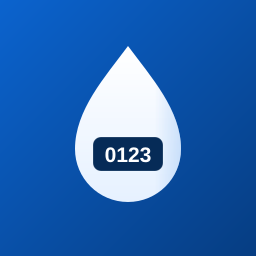
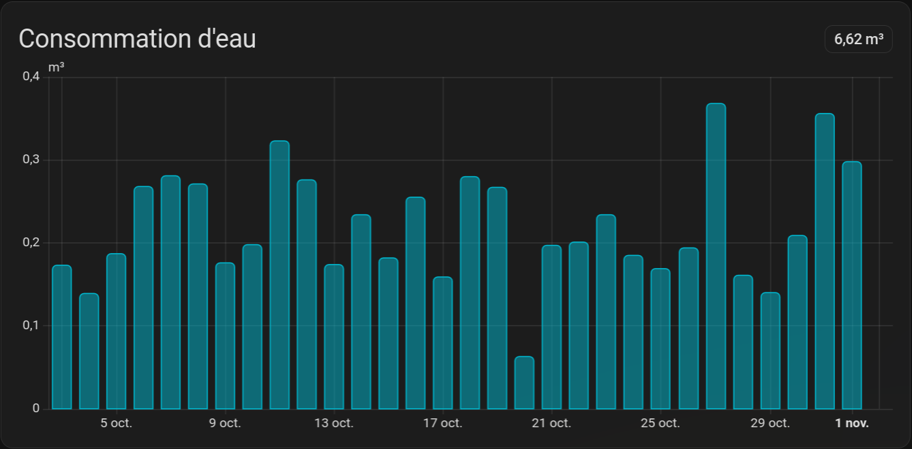

<p align="center">
  
</p>

# Sogedo Water for Home Assistant

[](https://hacs.xyz)
[](https://www.home-assistant.io)
[](https://github.com/girard-xyz/sogedo-ha/releases)
[](LICENSE)

**English** | [Français](README.fr.md)

An unofficial Home Assistant integration for [Sogedo](https://mon-compte.sogedo.fr) water meters. It pulls your daily consumption and meter index, backfills your full history, and feeds it into the **Energy Dashboard** — water and cost.



[](https://my.home-assistant.io/redirect/hacs_repository/?owner=girard-xyz&repository=sogedo-ha&category=integration)

## Table of contents

- [Why](#why)
- [Features](#features)
- [Requirements](#requirements)
- [Installation](#installation)
- [Setup](#setup)
- [Entities](#entities)
- [Energy Dashboard](#energy-dashboard)
- [How it works](#how-it-works)
- [Troubleshooting](#troubleshooting)
- [Data & privacy](#data--privacy)
- [Contributing](#contributing)
- [Disclaimer](#disclaimer)
- [License](#license)

## Why

The Sogedo customer portal only shows water consumption as a table. Home Assistant's Energy Dashboard needs **long-term statistics**, not a table.

This integration signs in to your account, converts the portal data into proper sensors and statistics, and keeps them up to date — so water usage appears next to electricity and gas, with history and cost.

## Features

- **Daily consumption** — water used on the last completed day (J-1), in m³.
- **Cumulative index** — current meter reading, `total_increasing`.
- **Full history** — 10 years of daily consumption backfilled as long-term statistics, ready for the Energy Dashboard.
- **Cost history** — consumption × the water price configured in the Energy Dashboard.
- **Automatic sign-in** — email and password are stored once; when the refresh token expires, the integration signs in again silently.
- **Late data handled** — Sogedo publishes with a delay, so the last 7 days are re-checked on every poll and placeholders are corrected.
- **Refresh history button** — re-run the backfill on demand (idempotent, safe to press any time).
- **Polls every 6 hours** — Sogedo only publishes daily data, there is nothing to gain from polling faster.

## Requirements

- Home Assistant **2024.4** or newer.
- A Sogedo online account (email + password).
- [HACS](https://hacs.xyz) for the recommended installation.

## Installation

### HACS (recommended)

1. Open **HACS → Integrations → ⋯ → Custom repositories**.
2. Add `https://github.com/girard-xyz/sogedo-ha` with category **Integration**.
3. Install **Sogedo Water**.
4. Restart Home Assistant.

You can also use the **Add repository** button above.

### Manual

Copy `custom_components/sogedo` into your Home Assistant configuration directory:

```
config/
└── custom_components/
    └── sogedo/
```

Then restart Home Assistant.

## Setup

1. Go to **Settings → Devices & services → Add integration**.
2. Search for **Sogedo Water**.
3. Enter the email and password of your Sogedo online account.
4. If your account has several subscriptions, pick the one to monitor.

Your credentials are stored in the Home Assistant config entry and used to open a session with Sogedo. You only have to sign in again if you change your Sogedo password or if Sogedo changes its login page.

## Entities

Entity IDs are localized to your Home Assistant language. The examples below use English (French in `README.fr.md`).

| Entity | Description |
|---|---|
| `sensor.daily_consumption` | Water used on the last completed day (J-1), m³ |
| `sensor.cumulative_consumption` | Current meter index, `total_increasing` |
| `sensor.sogedo_water_consumption` | Long-term statistic (no live entity) — **Energy Dashboard water source** |
| `sensor.sogedo_water_cost` | Long-term statistic (no live entity) — **Energy Dashboard cost source** |
| `button.refresh_history` | Re-run the history backfill |
| `update.sogedo_water_update` | Update notifications from HACS/Home Assistant |

> The two statistics (`sensor.sogedo_water_consumption` and `sensor.sogedo_water_cost`) have fixed IDs and do not change with the language.

## Energy Dashboard

1. Go to **Settings → Dashboards → Energy → Water sources → Add** (or edit the existing one).
2. **Mains water** → select `sensor.sogedo_water_consumption`.
3. Enter the water **price** (€/m³).

The integration sets the **cost** statistic (`sensor.sogedo_water_cost`) automatically the first time the backfill runs. The history graph and cost breakdown then show every day, including the backfilled years.

If you change the price, press **Refresh history** to recompute the cost series.

## How it works

- **Authentication** — Sogedo uses Azure AD B2C with the password flow disabled, so the integration drives the portal's own sign-in page, obtains an authorization code, and exchanges it for tokens. The refresh token is persisted; when it lapses, the stored credentials are used to sign in again.
- **Polling** — every 6 hours. Sogedo publishes data for the previous day, sometimes later.
- **Statistics** — the integration writes running cumulatives to the recorder, so the Energy Dashboard's daily *change* equals the real daily consumption (and cost).
- **Backfill** — on first setup, and on demand via the button, the full 10-year history is fetched in one-year chunks and written idempotently.
- **Late data** — each poll re-fetches the last 7 days and rewrites that tail, so days published late are corrected instead of being frozen at zero.

## Troubleshooting

**The Energy Dashboard shows no water use for recent days.**
Sogedo publishes J-1 at the earliest, sometimes with several days of delay. The sensors keep the last published value; press **Refresh history** to force a re-check once the portal has the data.

**"Sogedo backfill failed; retrying next poll" in the log.**
Usually a transient network/API error. The integration retries automatically; the **Refresh history** button forces it immediately.

**Home Assistant asks to re-authenticate.**
The password changed, or Sogedo changed its login page. Enter the email and password again — entities, history and dashboard settings are preserved.

**No data at all / wrong account.**
Remove the integration and add it again. History is preserved and the backfill is idempotent.

## Data & privacy

- The integration talks only to `mon-compte.sogedo.fr` and `login.mon-compte.sogedo.fr`.
- Your email and password are stored in Home Assistant's config entry (`.storage/core.config_entries`, like most Home Assistant integrations). The password is never sent anywhere except Sogedo's login page.
- No telemetry, no third-party server.
- This is an unofficial client: Sogedo can change its portal at any time, and the integration may need an update when it does.

## Contributing

Issues and pull requests are welcome.

```bash
python -m venv .venv
source .venv/bin/activate
pip install -r requirements_test.txt
pytest
```

The test suite runs against a real Home Assistant (`pytest-homeassistant-custom-component`), including the config flow and the history-statistics logic.

## Disclaimer

This project is not affiliated with, endorsed by, or supported by Sogedo. *Sogedo* and its portal belong to their respective owners. Use it at your own risk.

## License

[MIT](LICENSE) © girard-xyz
